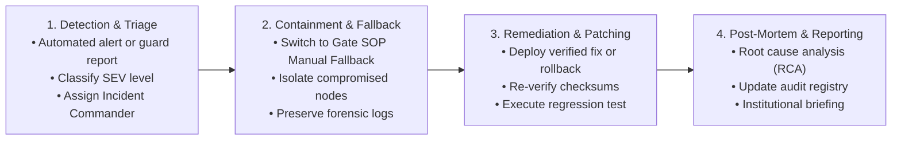

# GATEWISE AI — Incident Response & Monitoring Plan
**Classification:** Institutional Security & Site Reliability Operations  
**Applies To:** GATEWISE Guard, Admin Portal, Backend, and Gate Posts  
**Operational Contact:** Security Directorate & Campus IT Emergency Desk

---

## 1. Incident Classification Matrix

| Severity Level | Definition | Example Scenarios | Response SLA |
|---|---|---|---|
| **SEV-1 (Critical)** | Total gate verification outage or data security breach. | • All gates unable to verify identities. • Suspected unauthorized access to database. • Corrupt model weights causing false admits. | **$\le$ 15 min acknowledge** $\le$ 1 hour containment |
| **SEV-2 (High)** | Single gate station down or core integration degradation. | • Gate 02 offline while Gate 01 is functional. • Real-time SSE telemetry feed disconnected. • Google Drive sync failing continuously. | **$\le$ 30 min acknowledge** $\le$ 4 hours resolution |
| **SEV-3 (Medium)** | Non-critical administrative service impaired. | • Gemini AI assistant quota exhausted. • Slower analytics dashboard report generation. • Minor UI rendering glitch on older tablets. | **$\le$ 2 hours acknowledge** $\le$ 24 hours resolution |
| **SEV-4 (Low)** | Informational or minor cosmetic finding. | • Typo in public documentation FAQ. • Non-blocking warning log. | **$\le$ 24 hours acknowledge** Next release cycle |

---

## 2. Real-Time Telemetry & Health Monitoring Indicators

### 2.1 Application & Verification Services
- **Backend Availability & Health:** Monitored via `GET /health` (Target: 99.9% uptime).
- **Inference Latency:** Traced via `X-Response-Time-Ms` response header (Target: p95 < 40ms).
- **Authentication Failure Spikes:** Monitored via `AuditLog` where `action="AUTH_LOGIN_FAILED"` (Threshold: > 5 failures per minute from single IP triggers temporary IP ban).

### 2.2 Computer Vision & Memory Monitoring
- **Model Initialization Status:** Checked via `is_operational()` on startup; aborts container deployment if YuNet or SFace weights fail checksum validation.
- **Inference Concurrency:** Thread-safe execution bounded by `cv_pipeline.inference_lock`.
- **Worker Memory Consumption:** Monitored via Docker resource limits (Max 3GB per backend container).

### 2.3 Real-Time SSE Infrastructure
- **Connection Health:** Monitored via active listener queue count.
- **Heartbeat Continuity:** Keep-alive comments emitted every 15s (`: heartbeat\n\n`).
- **Slow Consumer Eviction:** Listeners with backlog exceeding 100 events are safely unsubscribed to prevent server memory bloat.

### 2.4 Privacy-Safe Logging Rules
The application enforces strict privacy sanitization in all system logs:
- ❌ **NEVER LOG:** Raw camera images, base64 strings, 128-D embedding vectors, passwords, JWT tokens, API keys, or private conversation texts.
- ✅ **PERMITTED LOGS:** Request IDs (`X-Request-ID`), response duration in milliseconds, truncated event IDs, actor employee IDs, gate codes, and coarse outcome categories.

---

## 3. Four-Phase Incident Containment Protocol

### Immediate Containment Actions:
1. **Gate Verification Interruption:** If the AI verification engine experiences an outage, security guards immediately switch to **Institutional Manual Fallback Procedure (SOP-01)**:
   - Guard inspects physical Institutional ID / Barcode.
   - Guard verifies active visitor passes via phone directory or printed manifest.
   - **Guards are never misled into believing an identity is verified when the system is offline.**
2. **Credential Compromise:**
   - Execute `SECRET_KEY` rotation in production environment.
   - Force global user session logout.
   - Audit `AuditLog` table for unauthorized actions.
