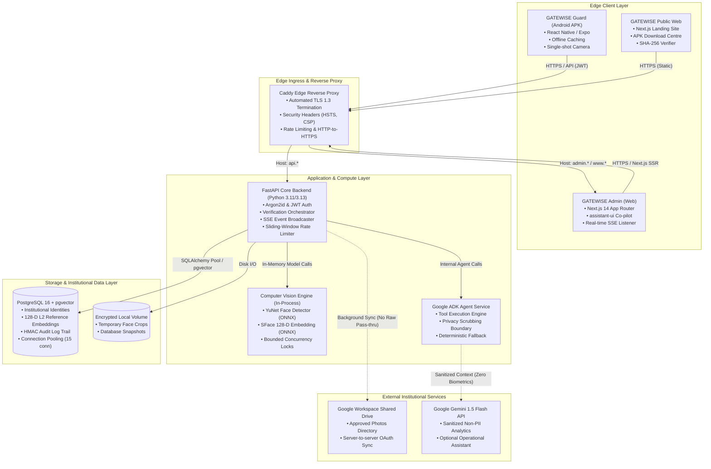

# GATEWISE AI — Production Architecture Specification
**Architecture Classification:** Institutional Distributed Security & Biometric Verification  
**Author:** Principal Software Architect & Infrastructure Lead  
**Version:** 1.0.0 (Production Release)

---

## 1. System Overview & Deployment Topology

The GATEWISE AI platform is deployed as a coordinated, hardened multi-tier architecture designed for low latency (< 100ms end-to-end verification), high availability, strict role separation, and absolute biometric data privacy.



---

## 2. Service Responsibilities & Component Matrix

| Service | Technology | Responsibilities | Security Posture |
|---|---|---|---|
| **Edge Reverse Proxy** | Caddy 2 (Alpine) | TLS termination, HTTP-to-HTTPS redirect, domain routing, DDoS protection, static caching. | Edge hardened; only ports 80/443 exposed. |
| **Web Portal & Website** | Next.js 14 Standalone | Administrator Command Centre, public documentation, signed APK downloads, server-rendered layouts. | Non-root `nextjs` user; runs inside private Docker bridge. |
| **FastAPI Core Backend** | Python 3.11 / Uvicorn | Session management, RBAC enforcement, cryptographic HMAC verification sealing, SSE broadcasting. | Non-root `gatewise` user; strict input validation. |
| **CV Inference Engine** | OpenCV 4.9 (YuNet + SFace) | Single-shot face detection, landmark alignment, Laplacian blur assessment, 128-D L2 embedding calculation. | Runs in-process with bounded threading; no network access. |
| **Relational & Vector DB** | PostgreSQL 16 + pgvector | Relational entities (users, gates, passes, events) and 128-D cosine distance matching. | Strictly unexposed to host network; isolated in `gatewise-internal` bridge. |
| **AI Assistant Service** | Google ADK + Gemini SDK | Conversational summaries, navigation directives, operational explainability. | Quarantined: Zero access to raw images or vector embeddings. |

---

## 3. Communication Protocols & Data Flows

### 3.1 Sovereign Gate Verification Flow
1. **Capture:** The guard taps "Capture & Verify" in GATEWISE Guard. The camera captures a high-resolution still frame.
2. **Transport:** Frame is compressed to JPEG, base64-encoded, and sent via `POST /api/v1/verification/verify` with `Authorization: Bearer <guard_jwt>`.
3. **Quality & Detection:** Backend decodes frame, verifies size (< 10MB), checks Laplacian variance (> 60.0), and runs YuNet face detection. If 0 faces or multiple faces are found, a clear recapture instruction is returned immediately.
4. **Embedding Generation:** SFace extracts a 128-dimensional L2-normalized embedding vector.
5. **Reference Matching:** Vector is compared against pre-warmed reference embeddings in memory and PostgreSQL using cosine similarity.
   - $\ge 0.90$: High-confidence identity match.
   - $0.70 - 0.89$: Potential candidate match.
   - $< 0.70$: Unknown person.
6. **Decoupled Clearance Check:** The system looks up the candidate's active access authorization. Even if the face matches, if clearance is expired or revoked, `is_authorized: false` is returned.
7. **Guard Sovereignty:** The guard reviews the candidate card and authorization status on screen and makes a sovereign physical decision (`GRANT_ENTRY`, `DENY_ENTRY`, `ESCALATE_TO_ADMIN`).
8. **Cryptographic Sealing:** Backend signs the complete record with HMAC-SHA256 non-repudiation signature and writes the transaction to PostgreSQL.
9. **Real-time Telemetry:** Event is dispatched to `EventBroadcaster`, which streams the event via SSE (< 1ms) to the Admin Command Centre.

### 3.2 Google Shared Drive Synchronization Flow
1. Synchronization runs asynchronously on schedule or via explicit administrator trigger (`POST /api/v1/repository/sync`).
2. Server queries Google Drive API using institutional credentials for the designated folder (`IIM_Sambalpur_Approved_Identities_2024_2026`).
3. Only filenames matching approved institutional naming convention (`{CATEGORY}_{ID}_{NAME}.jpg`) are processed.
4. YuNet verifies exactly one clear face per reference image; non-compliant images are placed into `unmapped-files` review queue.
5. SFace computes the 128-D vector; record is committed to PostgreSQL and memory cache is invalidated atomically.
6. **Zero Raw Cloud Exposure:** Photographs and embeddings remain strictly within the campus database; no reference photos are ever requested from Drive during gate verifications.

---

## 4. Environment Separation Architecture

To prevent cross-contamination and protect institutional privacy, GATEWISE AI strictly isolates three operational environments:

```
┌────────────────────────────────────────────────────────────────────────┐
│ DEVELOPMENT ENVIRONMENT                                                │
│ • Host: localhost:3000 / localhost:8000                                │
│ • Database: SQLite (file-based) or local Docker Postgres               │
│ • Identities: Synthetic test dataset (Aarav Sharma, etc.)              │
│ • Secrets: Local development placeholder secrets                       │
│ • Zero real student/faculty photographs or biometric vectors           │
└──────────────────────────────────┬─────────────────────────────────────┘
                                   │ CI/CD Pipeline
                                   ▼
┌────────────────────────────────────────────────────────────────────────┐
│ STAGING ENVIRONMENT                                                    │
│ • Host: staging.gatewiseai.internal                                    │
│ • Infrastructure: Containerized Docker stack matching Production       │
│ • Database: Managed PostgreSQL 16 with pgvector                        │
│ • Identities: Approved anonymized pilot cohort                         │
│ • Release Validation: Verification of candidate APK and web artifacts  │
└──────────────────────────────────┬─────────────────────────────────────┘
                                   │ Controlled Institutional Approval
                                   ▼
┌────────────────────────────────────────────────────────────────────────┐
│ PRODUCTION ENVIRONMENT                                                 │
│ • Host: gatewiseai.internal / admin.* / api.*                          │
│ • Infrastructure: Sovereign campus VM or Indian region cloud VPC       │
│ • Database: High-availability PostgreSQL with automated daily backups   │
│ • Identities: Institutionally authorized Drive repository              │
│ • Access: Strict RBAC; MFA enforced for Super Administrators           │
└────────────────────────────────────────────────────────────────────────┘
```

---

## 5. High Availability & Failure Recovery Strategy

- **Database Cold Starts / Connection Drops:** SQLAlchemy connection pool configured with `pool_pre_ping=True`, `pool_recycle=1800`, and automatic retry.
- **Model Warm-up:** OpenCV models are loaded and warmed with a synthetic frame during backend startup to eliminate first-request inference lag.
- **SSE Disconnects:** Browser clients automatically reconnect with exponential backoff; initial connection delivers latest committed snapshot so no events are lost.
- **Offline Guard Operation:** Guard APK queues uncommitted decisions in encrypted local storage (`expo-secure-store`) and flushes them when connectivity resumes.
