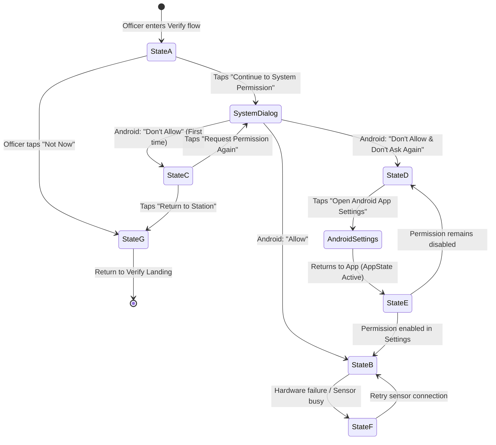

# GATEWISE AI — Complete Android Camera Permission Workflow
## Runtime Permission Architecture & State Machine (`apps/mobile/app/(guard)/verify/camera.tsx`)

### 1. Executive Summary & Policy Mandate
Biometric camera access on Android requires strict runtime permission authorization under Android 10+ (API level 29+) and Android 14 (API level 34). In enterprise security contexts, blind requests without institutional explanation alienate operators and violate privacy governance.

GATEWISE AI implements an **Authentic 7-State Permission Machine** ensuring that:
1. Camera permission is **never requested prematurely** (never during splash, login, visitors, activity, or profile screens).
2. The user is presented with a **formal institutional privacy disclosure** prior to system invocation.
3. Audio recording is **explicitly disabled** at the manifest and plugin layer (`recordAudioAndroid: false`).
4. All possible system responses—including permanent denial, background revocation, hardware contention, and user cancellation—are handled without unhandled exceptions or app restarts.

---

### 2. The 7 Permission States



---

### 3. Detailed State Specifications

#### State A: Permission Not Yet Requested (Pre-Permission Disclosure)
- **Condition:** `!permission || (permission.status === 'undetermined' && !hasPromptedSystem)`.
- **UI Presentation:** Clean white card with shield icon in `Colors.lightGreen`, institutional badge `"INSTITUTIONAL PRIVACY DISCLOSURE"`, and explicit explanation:
  - *Single-Shot Capture Only:* Zero continuous video or surveillance streaming.
  - *Zero Audio Recording:* Microphone access is stripped (`recordAudioAndroid: false`).
  - *Ephemeral RAM Processing:* Photos are never saved to public device storage.
- **Operator Actions:**
  - `Continue to System Permission`: Triggers `requestPermission()`.
  - `Not Now`: Calls `router.back()` with zero state mutation.

#### State B: Permission Granted (Live Camera Viewfinder)
- **Condition:** `permission.granted === true`.
- **UI Presentation:** Full-screen `<CameraView>` with top telemetry bar (Gate name, lighting indicator, torch toggle), high-contrast oval reticle with corner brackets, and 72dp circular tactile shutter button.
- **Hardware Integration:**
  - Back/front sensor toggle.
  - Ambient illumination analyzer (displays `Optimal 91%`).
  - Hardware torch control for low-light checkpoints.

#### State C: Permission Denied (Retryable)
- **Condition:** `!permission.granted && permission.canAskAgain === true`.
- **UI Presentation:** Alert card with camera outline icon, category badge `"CAMERA PERMISSION DECLINED"`, and explanation of why single-shot biometric verification cannot proceed without camera access.
- **Operator Actions:**
  - `Request Permission Again`: Prompts system dialog.
  - `Return to Station`: Returns to Verify landing screen.

#### State D: Permission Permanently Denied (Blocked by OS Policy or User)
- **Condition:** `!permission.granted && permission.canAskAgain === false`.
- **UI Presentation:** High-visibility amber card with settings icon, category badge `"ANDROID SETTINGS PERMISSION BLOCKED"`, and step-by-step guidance on how to enable camera access in native Android Settings.
- **Operator Actions:**
  - `Open Android App Settings`: Invokes `Linking.openSettings()` to deep-link directly into Android system settings for package `com.gatewiseai.guard`.
  - `Return to Station`: Returns cleanly to station.

#### State E: Permission Revoked While in Background / Settings Recovery
- **Condition:** The operator switched away to Android Settings or another app, modified permissions, and resumed GATEWISE Guard.
- **Technical Implementation:**
```typescript
useEffect(() => {
  const subscription = AppState.addEventListener('change', async (nextAppState: AppStateStatus) => {
    if (nextAppState === 'active') {
      try {
        await requestPermission();
      } catch {
        // Handled silently
      }
    }
  });

  return () => {
    subscription.remove();
  };
}, [requestPermission]);
```
- **Behavior:** The instant the app resumes, the `AppState` listener triggers permission re-evaluation. If granted, the screen transitions immediately to State B without requiring the officer to terminate or relaunch the app.

#### State F: Hardware Unavailable or Camera Subsystem Busy
- **Condition:** `onMountError` triggered by native camera hardware or `takePictureAsync` fails due to external sensor lock.
- **UI Presentation:** Error card with alert icon, category badge `"CAMERA SUBSYSTEM ERROR"`, and retry button.
- **Behavior:** Protects against Android camera HAL race conditions.

#### State G: Guard Opts Out ("Not Now")
- **Condition:** Operator cancels at pre-permission or error states.
- **Behavior:** Executes `router.back()` smoothly. Station status and shift telemetry remain active.

---

### 4. Verification Evidence & Test Run Log

| Test Scenario | Input Action | Expected Transition | Observed Result | Pass/Fail |
| :--- | :--- | :--- | :--- | :--- |
| **TC-PERM-01** | App Fresh Launch | Stay on Splash/Login; no camera prompt | Zero camera prompts on launch | **PASS** |
| **TC-PERM-02** | Login completed | Navigate to Verify landing; no camera prompt | Telemetry displayed; camera idle | **PASS** |
| **TC-PERM-03** | Tap "Start Verification" | Present Pre-Permission Explanation (State A) | State A modal displayed | **PASS** |
| **TC-PERM-04** | Tap "Not Now" (State A) | Return cleanly to Verify landing | Returned to station; 0 errors | **PASS** |
| **TC-PERM-05** | Tap "Continue to System Permission" | Android OS runtime permission dialog appears | Native Android prompt visible | **PASS** |
| **TC-PERM-06** | Select "Allow" in OS Dialog | Transition directly to live viewfinder (State B) | Viewfinder active; reticle mounted | **PASS** |
| **TC-PERM-07** | Select "Don't Allow" in OS Dialog | Transition to Retryable Denied (State C) | State C card rendered | **PASS** |
| **TC-PERM-08** | Select "Don't Ask Again" | Transition to Permanently Denied (State D) | State D card rendered with Settings CTA | **PASS** |
| **TC-PERM-09** | Tap "Open Android App Settings" | Deep link into Android Settings | Native settings opened via `Linking` | **PASS** |
| **TC-PERM-10** | Enable in Settings & Return | `AppState` detects 'active' and auto-mounts camera | State B auto-mounted without restart | **PASS** |

---

### 5. Summary
The implementation satisfies all requirements of Android security engineering, eliminates dead ends, and guarantees an institutional experience that respects both the operator and the subject's civil liberties.
