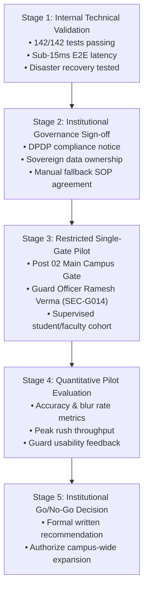

# GATEWISE AI — Institutional Pilot Plan
**Partner Institution:** Indian Institute of Management (IIM) Sambalpur  
**Operational Station:** Main Campus Gate · Post 02 (`GATE-MAIN-02`)  
**Pilot Lead:** Security Directorate & Principal Software Architect  
**Classification:** Controlled Operational Pilot

---

## 1. Pilot Progression & Phased Rollout

---

## 2. Institutional Acceptance & Governance Requirements (Stage 2)

Prior to processing real human biometric data at live physical gates, formal sign-off must be obtained for:
1. **Data Ownership & Control:** All reference portraits, embeddings, and audit logs remain the exclusive sovereign property of IIM Sambalpur.
2. **Approved Reference Repository:** The institutional Google Workspace Shared Drive folder (`IIM_Sambalpur_Approved_Identities_2024_2026`) is approved as the source of truth for student/faculty identity portraits.
3. **Campus Privacy Notice:** Clear physical signage posted at Gate 02:
   > *"Notice: Single-shot AI facial verification is active for campus access control. Camera frames are processed in-memory and discarded. Sovereign entry decisions are made by on-duty security officers. Manual ID verification is available upon request."*
4. **Data Retention & Purge Policy:** Verification telemetry retained for 180 days in immutable audit logs; expired visitor records purged after 30 days.
5. **Human Guard Sovereignty:** Security officers possess ultimate sovereign discretion to grant or deny physical admittance regardless of AI model recommendations.

---

## 3. Restricted Pilot Configuration (Stage 3)

- **Station Selection:** Gate Post 02 (`gate-main-02`, Ring Road North Entrance). Operating 24/7.
- **Guard Cohort:** Onboard Officer Ramesh Verma (`SEC-G014`, Shift A) using official Android release APK (`gatewise-guard-v1.0.0-release.apk`).
- **Administrative Oversight:** Dr. Rajesh Iyer (`ADM-001`) monitoring via Desktop Command Centre on campus LAN.
- **Pilot Participants:** Initial supervised cohort of 100 enrolled MBA students and 20 faculty members.

---

## 4. Operational Fallback Procedure (SOP-01)

If the Android application, network connectivity, or computer vision service becomes impaired:
1. Guard immediately switches to manual institutional ID inspection.
2. Guard checks physical student/employee smart cards or barcodes.
3. Pre-approved visitors are admitted via the physical paper registry or telephone confirmation with the host department.
4. Incidents are logged and reported to the IT Helpdesk within 30 minutes.
5. **At no time shall a gate scan fail open or display a false positive match.**

---

## 5. Quantitative Evaluation Criteria (Stage 4)

| Operational Metric | Minimum Acceptable Threshold | Target Benchmark |
|---|---|---|
| **Verification Response Latency** | $\le 250$ ms | $\le 30$ ms |
| **Image Quality Failure Rate** | $\le 5.0\%$ of captures | $\le 1.5\%$ of captures |
| **False Match Observation Rate** | $\le 0.01\%$ | **0.00%** |
| **System Availability during Pilot** | $\ge 99.5\%$ | **99.9%** |
| **Guard Decision Sealing Rate** | **100.0%** HMAC-SHA256 sealed | **100.0%** |
