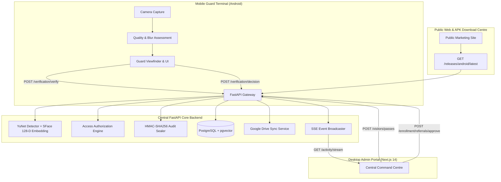

# GATEWISE AI 1.0 — Platform Integration Report
**End-to-End Architectural Integration & System Synthesis**  
*Release Version: 1.0.0 | Date: November 2026*

---

## 1. Architectural Synthesis

GATEWISE AI 1.0 unites three interconnected experiences into a single, cohesive institutional security platform:

1. **GATEWISE Guard (Android Native Mobile):** Built with Expo, React Native, and TypeScript. Acts as the physical edge terminal for security guards at campus gate posts.
2. **GATEWISE Admin (Desktop Web Portal):** Built with Next.js 14, React, and TypeScript. Provides Central Command Centre monitoring, identity management, visitor pass issuance, and audit trails.
3. **GATEWISE Website (Public Showcase & Release Hub):** Built with Next.js 14, Three.js, and Tailwind CSS. Serves public documentation, an interactive 3D campus visualization, and the verified Android APK download centre.
4. **GATEWISE Core Engine (Central FastAPI Backend):** Central authority executing computer vision inference (OpenCV YuNet + SFace), PostgreSQL/SQLite data persistence, Google Drive photo synchronization, and cryptographic audit sealing.

---

## 2. Single Source of Truth Enforcement

- **Database as Sole Authority:**
  - Neither the mobile application nor the web portal maintain divergent state models.
  - All identity states (`ACTIVE`, `SUSPENDED`, `GRADUATED`), authorizations (`AUTHORIZED`, `EXPIRED`, `UNAUTHORIZED`), and visitor passes (`EXPECTED`, `CHECKED_IN`, `CHECKED_OUT`, `EXPIRED`) originate strictly from the backend database schema.
- **Server-Side Gate Assignment:**
  - A guard's active station assignment is strictly looked up from `GuardGateAssignment` in the database.
  - Any client-submitted spoofed gate identifier is ignored and overwritten by the authoritative station ID.
- **Unified Error Responses:**
  - All errors adhere to standard RFC 7807 problem details via FastAPI HTTPException handlers.

---

## 3. Real-Time Event Telemetry & Broadcasting

- Live verification events are published directly to the Central Command Centre using Server-Sent Events (SSE) at `/api/v1/activity/stream`.
- Administrators can monitor throughput across all gates simultaneously or filter by a specific gate post.
- Events stream with full cryptographic signatures, enabling instant audit verification.

---

## 4. Release Distribution & Tamper Verification

- The public download portal (`/download`) reads release metadata dynamically from `/releases/android-release.json`.
- If an APK release has not yet been cryptographically verified and signed, the download button remains in an honest, disabled state (`PENDING_PUBLICATION`), preventing broken links or untrusted sideloading.
- The `scripts/verify_and_publish_apk.py` CLI tool validates SHA-256 digests, ZIP container integrity, and AndroidManifest presence prior to publication.
